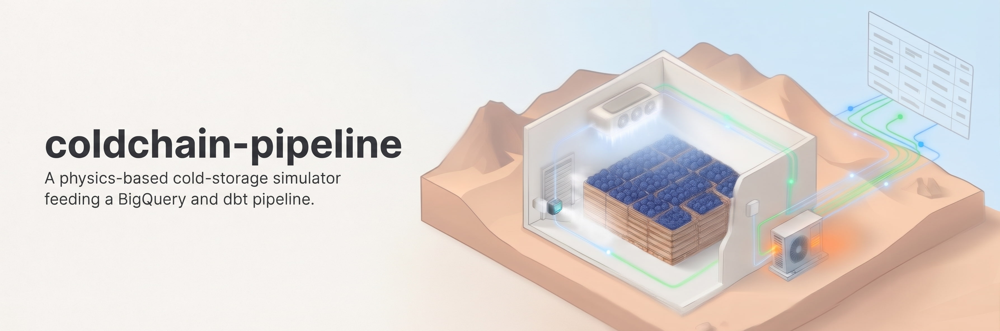
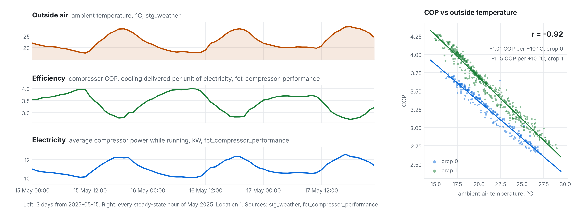
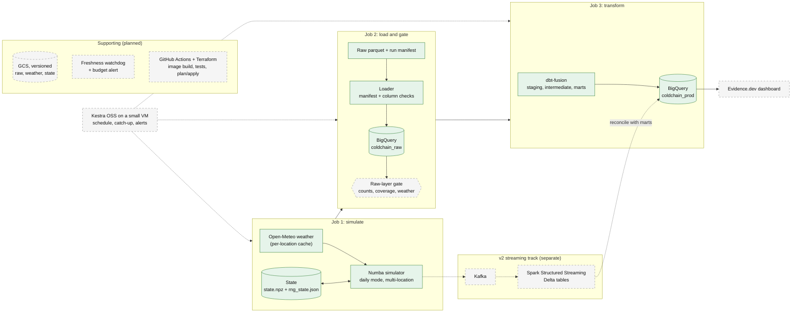

  <picture>
    <source media="(prefers-color-scheme: dark)" srcset="docs/img/header-dark.jpg">
    

A synthetic cold-storage data platform: a physics-based simulator generates raw SCADA-style
data for a fruit-packing facility's cold rooms, and a dbt + BigQuery project turns it into
analytics-ready marts.

<picture>
  <source media="(prefers-color-scheme: dark)" srcset="docs/img/hero-power-dark.png">
  
</picture>

*Hot afternoons cost efficiency: COP falls from about 4.0 to 2.8 and compressor power rises by about 2.5 kW. Every line comes from dbt models in BigQuery (`stg_weather`, `fct_compressor_performance`). The data is synthetic.*

**Scale:** two locations over 30 days produce about 251 million raw rows (250.9M of them telemetry, 16 GB). The dbt layer pivots them into one row per location per 100 ms, which is 51.84M rows (864,000 per location per day) at each telemetry stage, and 16.8M steady-state readings in `fct_compressor_performance`. Keeping that fast and correct in BigQuery took day-partitioned incremental models, checkpoint tables that carry state across days, and forward fills split by day to stay within BigQuery's sort limits.

<!-- business section goes here -->

## About the data

The data is synthetic, but the simulator is not a closed refrigeration loop. Besides the physics
(room heat balance, refrigerant cycle, evaporator frost and defrost, humidity and gas exchange), it
models a facility that is operated by people and instrumented imperfectly:

- **Stochastic operations**: truck arrivals and dispatches that vary by hour and weekday, doors left
  open, scheduled downtime, and crop and refrigerant changeovers.
- **Human behavior**: drivers and employees whose fatigue (time of day, weekday, end of month) and
  carelessness change their probability of making an error.
- **Imperfect instrumentation**: sensor noise, per-sensor sampling intervals, background dropout,
  per-channel outages and facility-wide outages on the sensor tables.
- **Real weather**: outdoor conditions are real historical data for the configured site
  ([Open-Meteo](https://open-meteo.com/)), and the indoor climate responds to them through the
  envelope and the doors.

Because the simulator knows what actually happened, its event ledgers can serve as ground truth for
checking the marts, which real plant data does not allow (planned, see the roadmap). The simulator
has not been validated against a real installation; see `simulation/README.md` for assumptions and
limits.

## Architecture

Green boxes are built and running; dashed grey boxes are planned (see the roadmap).

## What is in the repo

| Path | Contents |
|---|---|
| `simulation/` | Numba-JIT Python simulator: room thermal balance, refrigeration cycle (R404A/R134a polynomial fits), evaporator frost and electric defrost, humidity/CO2/O2, door and logistics events, sensor and telemetry-loss layers. Writes raw parquet tables. |
| `bq/` | Shell helpers and table schemas for creating the raw BigQuery tables and loading the simulator's parquet chunks. |
| `dbt_project/` | dbt project (BigQuery): `staging` views, `intermediate` models, `marts` (dimensions and facts), seeds generated from the simulator configs, and tests. |

## Raw tables produced by the simulator

`telemetry`, `batch_sensors` (long format: tag, timestamp, value) and the event/ledger tables
`compressor_events`, `humidifier_events`, `door_events`, `crop_rotation_events`,
`refrigerant_rotation_events`, `downtime_sequence_events`, `lp_trip_events`,
`defrost_events`, `inbound_orders`, `outbound_orders`, `inbound_pallet_history`,
`outbound_pallet_history`. Weather comes from satellite/reanalysis data.

## dbt design notes

- Large intermediate models are incremental with `insert_overwrite`, partitioned by day. Each run
  recomputes whole days touched by new rows (day-aligned bounds), so window functions stay correct.
- Window state that crosses a day boundary (for example the last decisive compliance status) is
  carried in a seed row read from the model's own previous output.
- **"Seed" has two meanings here.** dbt seeds are CSV files loaded with `dbt seed` (`dbt_project/seeds`).
  A "seed row" in the incremental models is unrelated: it is the last row of the model's own previous
  output, read back so that window functions continue across a day boundary.
- Two models run window functions over the full telemetry history and needed their own design.
  `int_temperature_excursion_events_enriched` splits each compliance status into contiguous phases
  (`phase_seq`) and carries the last phase, the excursion counter and the last known status across
  days in a seed row. `int_door_recovery_events` needs no seed: its slice starts at the day of the
  last door close before the new data, so a recovery that is still open is rebuilt from complete
  data. Both were checked by starting an incremental run from chosen days and comparing it with a
  full refresh: no row differs from the full refresh and there are no duplicate keys.
- The remaining models read event ledgers, staging tables or each other at event scale, and are
  rebuilt in full on every run.
- `ingested_at` is the max over every input of a row, so late-arriving data re-triggers its own day.
- `chain_test.sh`, `hourly_test.sh` and `mart_test.sh` compare per-day fingerprints of an
  incremental run against a snapshot of a full refresh.
- Seeds (`dbt_project/seeds`) are generated from the simulator configs:
  `python simulation/generate_dbt_seeds.py` (run it from `simulation/`).
- Sensor tags are configuration-driven (`telemetry_sensor_tags` / `batch_sensor_tags` in
  `dbt_project.yml` plus `seed_sensor_polling_config`). A singular test,
  `assert_sensor_tags_consistent`, fails the build if a raw tag is missing from either, so a
  rename cannot silently drop rows.

## Running

1. Simulator: `python simulation/run.py --location 1 --days 1` simulates one UTC day of one location and
   continues from its saved state next time (`--hours`, `--seed`, `--smoke-test` and more; see
   `simulation/README.md`). Each location has its own run directory and weather cache, so locations
   can run in parallel. Configuration lives in `simulation/configs/`.
   Dependencies include numpy, numba, pandas, pyarrow, CoolProp, timezonefinder, reverse_geocoder
   and pycountry. Numba compilation is cached automatically (about a minute on a cold start).
2. Load the raw parquet tables into a BigQuery dataset named `coldchain_raw` with the helpers in
   `bq/`: `bash bq/create_tables.sh` once, then
   `bash bq/load_chunks.sh simulation/runs/location_1 <first> <last>` (see `bq/README.md`).
3. `cd dbt_project && dbt deps && dbt seed && dbt build` with a profile named `coldchain_pipeline`.
   The source project and dataset names are in `dbt_project/models/staging/sources.yml`.

## Status

Work in progress. The simulator, the raw layer and the BigQuery loading are working. The dbt marts
for the facility's core operations (room conditions, compressor and humidifier cycles, doors,
downtime, temperature compliance, inventory and orders) are built, and so are the defrost,
compressor-cycle and low-pressure trip facts. The incremental chain is checked against full
refreshes, including the models that need state from earlier days. Column-level tests
(`schema.yml`) and the dashboard are the current work.

Evaporator frost, electric defrost, low-pressure trips and the airflow interlock were added to the
simulator later, motivated by a separate long-running contract project in DataAnnotation. They are
exported as raw tables (`defrost_events`, and `lp_trip_events` for low-pressure trips) and
telemetry (`t_coil_evap_c`, `evap_air_velocity_m_s`). Every compressor state change in
`compressor_events` carries a `switch_reason` (thermostat, defrost, downtime, low-pressure trip,
airflow interlock), and the reason codes are decoded in the marts through seeds generated from the
simulator config. The dbt layer ingests all of this and builds defrost-cycle, compressor-cycle and trip-episode facts
from it. The low-pressure trip models have only been run on empty data so far, because the
simulated history does not yet contain trips; a run that triggers them is still to do.

This repository started as a Data Engineering Zoomcamp project. The submitted version is tagged
[`zoomcamp-submission`](../../tree/zoomcamp-submission). The current version is a complete, ground-up rewrite built for much larger data volumes and incremental processing.

## Roadmap

Items are listed in the order planned. Done means merged and checked against a full refresh or a test.

| # | Item | Status |
|---|---|---|
| 1 | **Incremental processing for the window-function models**: the large intermediate models run as day-partitioned `insert_overwrite` models. The two that need history from earlier days carry state across the day boundary in a seed row (`int_temperature_excursion_events_enriched`, `int_door_recovery_events`). Each was checked by starting an incremental run from chosen days and comparing it with a full refresh (`dbt_project/test_helpers/`). | Done |
| 2 | **Defrost and low-pressure trip analytics in dbt**: wire the new raw tables into the existing models. Classify every compressor stop by cause using `switch_reason`; defrost and trip windows in the state timeline; defrost recovery and cause attribution in the compliance models; per-defrost, per-trip and per-compressor-cycle fact tables; a shared `int_telemetry_derived` model that `fct_compressor_performance` filters. Checkpoint tables (`ck_*`) seed the forward-fill models so incremental runs match a full refresh. Verified on a full refresh of two locations over 30 days, and by incremental-versus-full comparisons from chosen cutoffs. The low-pressure trip path is only verified on empty data, because the simulated history contains no trips yet. | Done |
| 3 | **Docker**: one simulator image, used locally with Compose, in CI and later as a cloud job. | Planned |
| 4 | **History generation**: simulate a long history for several locations as consecutive daily chunks (one UTC day each; daily mode and multi-location support are in the simulator) and load it into BigQuery. | Planned |
| 5 | **Unattended daily run**: Kestra triggers separate jobs that simulate the next day, load it behind completeness gates and run dbt, with state kept in versioned storage. | Planned |
| 6 | **Tests and dashboard**: `schema.yml` with column tests, defrost/trip sanity tests, ground-truth checks (singular dbt tests that recompute mart figures from the simulator's raw event ledgers and require them to match), and an Evidence.dev dashboard. | In progress |
| 7 | **CI and infrastructure as code**: GitHub Actions for tests and `dbt build`; Terraform for the bucket, BigQuery tables and service accounts. | Planned |
| 8 | **v2, streaming and Spark** (separate track, started only after the batch pipeline above is complete): the simulator streams its output through Kafka into Spark Structured Streaming, and the streaming results are reconciled with the BigQuery marts for the same days. A second, reduced physics-only version of the simulator could run next to the full one as a digital twin-style reference model: the full simulator, with its deliberately imperfect telemetry, plays the role of the real plant, and the reduced model's deviations from it are monitored. This is digital twin-style only, a simulation-based comparison, since there is no physical plant behind the data. | Planned, not started |
